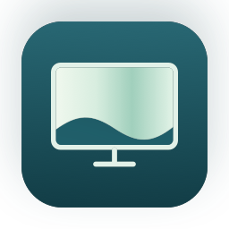

<p align="center">
  
</p>

# DeskVeil

Keep your Mac working while you're away from your desk.

DeskVeil is a macOS menu bar app that blocks physical keyboard, mouse, and trackpad input while allowing automation and app switching to continue. You can also dim your displays and keep your Mac awake during a session.

Requires macOS 13 or later. Available in English and Korean. Choose a language in DeskVeil Settings and click Apply and restart, or leave it set to Follow macOS settings.

## Features

- Dim supported displays and restore their original brightness and colors when the session ends.
- Check brightness per display, dim individual screens, and identify monitors by showing a number on each screen.
- Prevent sleep and idle locking during a session, with optional closed-lid operation.
- Keep a screen cover in place if input blocking ends unexpectedly, until you explicitly dismiss it.

## Getting started

1. Open DeskVeil's settings and grant Accessibility access in System Settings.
2. Enable screen dimming if you want your displays hidden. Choose any sleep-prevention or closed-lid options you need.
3. Run a 15- or 60-second input blocking test from settings. Check that physical input is blocked and your automation still works. This test leaves displays on and does not test closed-lid operation.
4. Start a session from the menu bar or use the shortcut below.

| Action | Default shortcut |
| --- | --- |
| Start or end a session | `⌃⌥⌘L` |
| Emergency release | `⌃⌥⌘U` |

By default, ending a normal session switches to the macOS lock screen. Emergency release restores input and brightness without requesting a lock. Both shortcuts can be changed in settings.

Click the menu bar icon to see display status and brightness. Use the round power buttons to dim or restore individual displays, or click a monitor's name to show its number on the physical screen.

## Limitations

- DeskVeil does not replace the macOS password lock. Process-generated input is intentionally allowed; test remapping tools and virtual HID devices before relying on input blocking.
- Display dimming does not switch off a monitor's physical power. Support depends on the monitor and connection, and some backlight glow may remain.
- After an unexpected release, dismiss the screen cover with the emergency shortcut or the menu's reveal action. The cover may also appear in remote sessions. It cannot guarantee privacy if the app exits or the cover fails to display.
- Closed-lid operation requires a helper installed with administrator approval. Changes to the helper or signing identity may require approval again.

## Development

Requires Swift 5.9 or later, Xcode Command Line Tools, and Python 3.9 or later for the checks. The app has no external package dependencies.

```sh
git clone https://github.com/Yon-Fandorin/deskveil.git
cd deskveil
env SOFTLOCK_BUNDLE_ID=dev.local.softlock.development \
    SOFTLOCK_SIGNING_IDENTITY=- \
    SOFTLOCK_APP_PATH="$PWD/dist-tests/DeskVeil-dev.app" \
    zsh build.sh
```

The app is written to `dist-tests/DeskVeil-dev.app` and is not launched automatically. Builds are ad-hoc signed, so rebuilding may require granting Accessibility access again.

Quit the installed app and restore your displays before testing: development builds share its recovery data. Do not replace an installed power helper with a development build.

```sh
env CLANG_MODULE_CACHE_PATH="$PWD/.build/clang-cache" SWIFTPM_MODULECACHE_OVERRIDE="$PWD/.build/swift-cache" swift test --disable-sandbox
python3 -B Tests/check_release_guard.py
```

For a UI preview without input blocking, brightness changes, or power control, run `zsh Tools/DesignPreview/build.sh`. See the [engineering notes](docs/engineering.md) (Korean) for architecture and verification details.

## License

[MIT](LICENSE)
